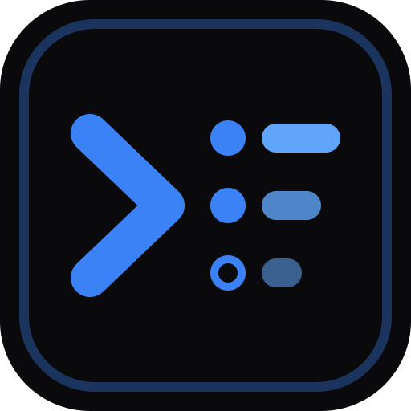
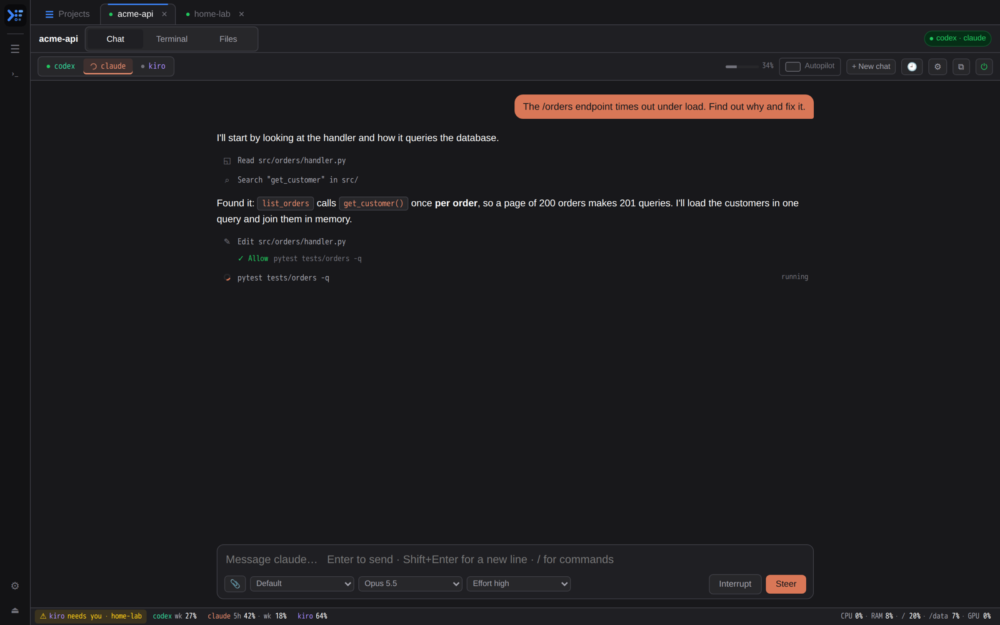
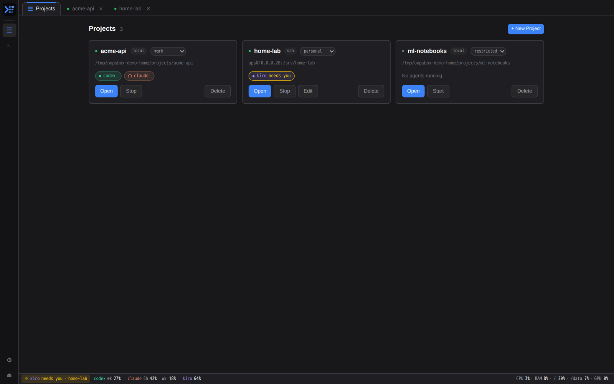
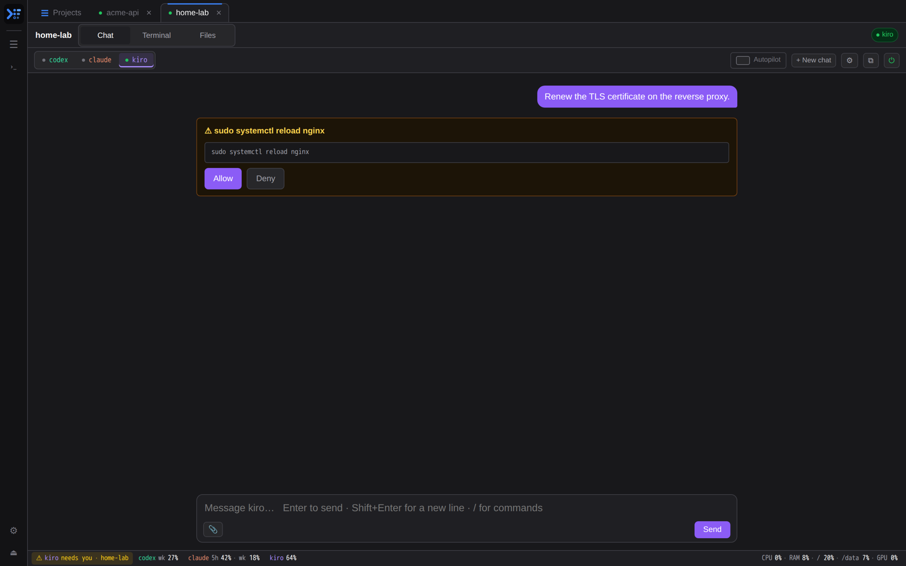
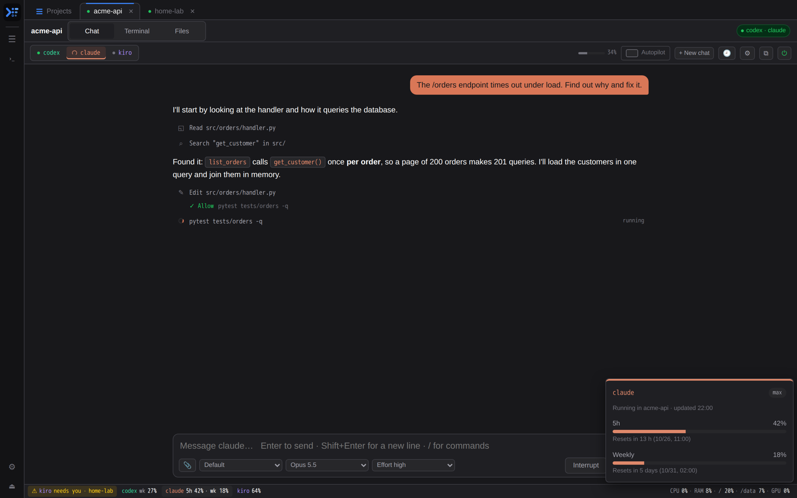
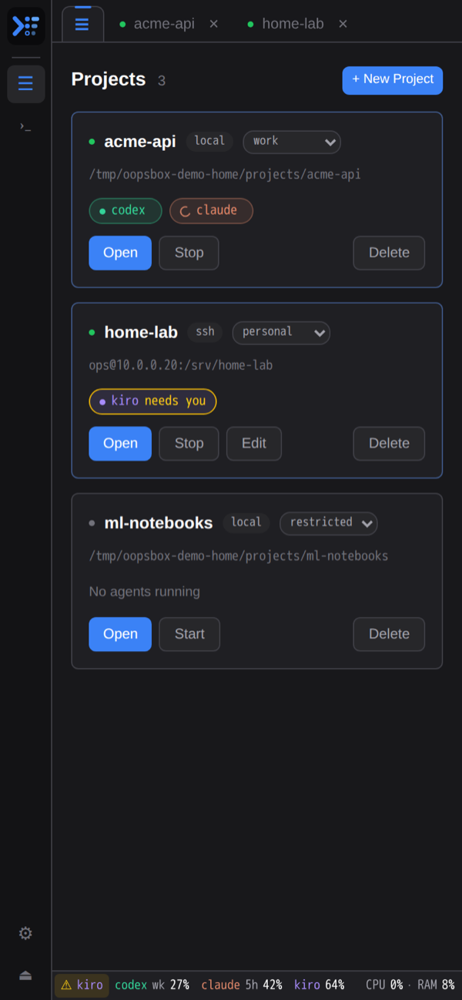
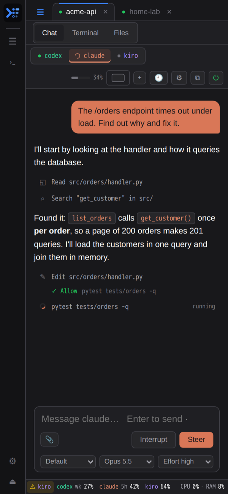
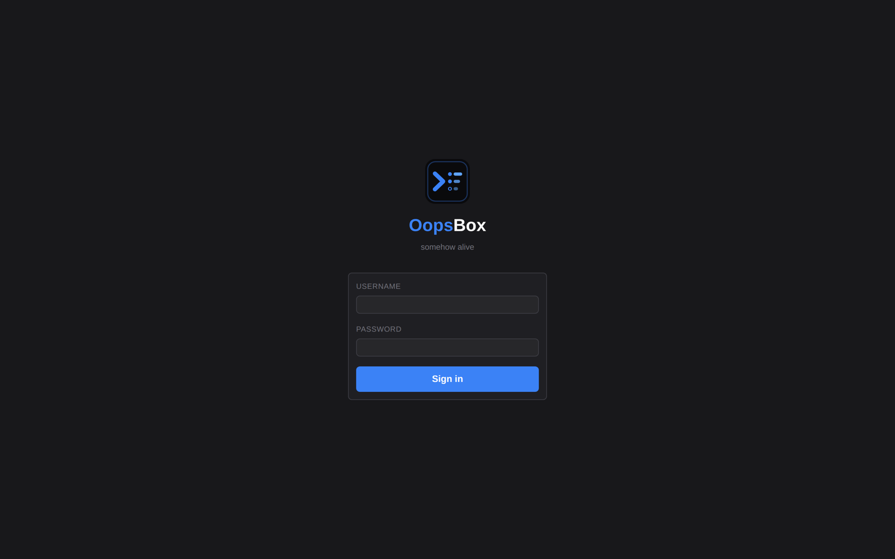

<p align="center">
  
</p>

<h1 align="center">OopsBox</h1>

<p align="center">
  <em>A browser console for running AI coding agents on your own server. Works on iPad. Started as a weekend project. Still going.</em><br>
  <em>在瀏覽器裡操控 AI coding agent 的主控台，跑在你自己的伺服器上。支援 iPad。本來是個週末專案。還在繼續。</em>
</p>

<p align="center">
  <a href="#english">English</a> · <a href="#繁體中文">繁體中文</a>
</p>

<p align="center">
  
</p>

---

## English

I wanted to code on my iPad: no local IDE, no VPN, just a browser. That turned into OopsBox, a web console that runs **Claude Code, Codex and Kiro** on a server you own and lets you drive all three from any device.

Each agent gets a real chat: its models, modes, slash commands, permissions and conversations, the same things its own terminal UI offers. When the chat is not enough, the same conversation continues in a real terminal one click away.

> Every screenshot here comes from a demo instance with made-up projects.

**New here?** The [user guide](docs/user-guide.md) walks through everything below.

### screenshots

<p align="center">
  <br>
  <em>Projects: every project, its agents (a spinner while one works, yellow when one needs you), and what you can do with it.</em>
</p>

<p align="center">
  <br>
  <em>Kiro wants to reload nginx. The status bar says so on every page, and your phone gets a push notification.</em>
</p>

<p align="center">
  <br>
  <em>Each agent's account usage and the machine's load live in the status bar. Tap one for the details.</em>
</p>

<p align="center">
  
  &nbsp;
  <br>
  <em>Same thing on a phone.</em>
</p>

<p align="center">
  <br>
  <em>"somehow alive": still an accurate project description.</em>
</p>

### features

**Three agents, one chat**
- Claude Code, Codex and Kiro, each in its own colour, side by side in every project. Switch with one tap.
- Models, reasoning effort and modes (plan, read-only, full access…) from pickers.
- Slash commands become what they should be: `/model` is a picker, `/usage`, `/context`, `/mcp` and friends are panels, and anything only a terminal can do hands over to the Terminal tab.
- Permissions show as Allow / Deny cards. **Autopilot** allows everything for a conversation.
- Send a message while the agent works to steer the current turn, or interrupt it.
- Past conversations, switch between them, rewind (where the agent supports it), edit each agent's config files and launch arguments.
- Attach files and images (saved into the project), and `@` to search project files.
- **Open in Terminal** continues the same conversation in the agent's own CLI.
- **Experimental:** Gemini CLI, Goose and OpenCode, over ACP, if they are installed. They run, but have not been checked against their own CLIs yet.

**Agents that keep running**
- Closing the page does not stop anything. Restarting OopsBox brings back the agents that were running, on the conversation they were in.
- An agent stopped by you stays stopped.

**Know when you are needed**
- A spinner on an agent while it works.
- "⚠ kiro needs you" in the status bar and a count in the tab title when an agent waits for a permission or an answer.
- **Push notifications** (Web Push) to every device that turned them on, even with OopsBox closed. Tapping one opens that agent's chat.
- **Usage alerts** when an agent's limit passes a threshold you set (default 90%), once per reset period.

**Projects**
- Local projects, or SSH projects whose files are on another machine: the agents run here, on the remote folder mounted over sshfs, and run commands there with `remote <command>`. Nothing to install on the remote machine.
- **Folders**: give a project more folders its agents may work in.
- A Projects tab with a card per project: agents, Start / Stop, Agents, Edit, Delete.
- **Choose each project's agents** when you make it, and change them later. OopsBox checks which agents are installed and ticks those for you.
- Classification per project (personal / work / restricted) is the ceiling: it decides which agents may ever work on it, whatever is ticked; a stricter one stops the agents it blocks.
- Deleting a project keeps its folder and chats unless you ask for them to go, and you type the name to confirm. Create it again and it picks them up.

**Terminals**
- A terminal per project, plus as many standalone shells as you want: each press of `›_` opens another tab.
- Each shell is its own daemon (ttyd + dtach under systemd): it survives closing the page and restarting OopsBox.
- A toolbar with the keys a touchscreen lacks (^C, Tab, arrows, Esc…), and copy.

**Files**
- File manager with upload, download, rename, delete; side-by-side SFTP for SSH projects.
- Monaco editor for code, Markdown preview, images and PDFs inline.

**Everywhere**
- Project tabs; when there are more than fit, `▾ N` lists them all.
- Layouts for desktop, iPad and phone. Installable as an app (PWA).
- Dark theme, one colour per agent: Claude orange, Codex green, Kiro violet.
- Login with PBKDF2-hashed passwords; nginx checks every route.

### how it works

```
browser ─ nginx (auth on every route, HTTPS through tailscale serve)
          ├─ FastAPI / uvicorn ── chat sessions ── claude   (stream-json control protocol)
          │                                     ├─ codex    (app-server JSON-RPC)
          │                                     ├─ kiro-cli (ACP)
          │                                     └─ gemini / goose / opencode (ACP, experimental)
          └─ /terminal/<name>/ ── ttyd ── dtach ── bash      (one systemd user unit each)
```

- Agents are child processes of OopsBox, driven through the protocols their own UIs use. Conversations live on disk; each agent resumes its own session when it starts again.
- Terminals are `systemd --user` units, so they outlive OopsBox. nginx learns their ports from `/tmp/oopsbox-<name>/ttyd.port`.
- Usage comes from each agent's own `/usage`, checked every 10 minutes for alerts.

### install

OopsBox runs on a Linux host with systemd. It is developed on Ubuntu 24.04.

1. **System packages**: `nginx`, `ttyd` (1.7+), `dtach`, `git`, `sshfs` and `sshpass` (SSH projects), Python 3.12, Node.js.
2. **Agents**: install and log in to the ones you want: `claude` (Claude Code), `codex`, `kiro-cli`; experimentally `gemini`, `goose`, `opencode`. **Settings → Agents** shows what OopsBox finds.
3. **OopsBox**:
   ```bash
   git clone https://github.com/MountainShan/OopsBox.git && cd OopsBox
   python3 -m venv .venv && .venv/bin/pip install -r requirements.txt
   ln -s "$PWD/bin" ~/bin            # terminal scripts nginx and OopsBox call
   loginctl enable-linger "$USER"    # terminals keep running without a login session
   ```
4. **Service**: run `.venv/bin/python -m uvicorn dashboard.main:app --host 127.0.0.1 --port 5000` as your user (a systemd unit with `Restart=on-failure` works well).
5. **nginx**: put it in front on the port you like, with `auth_request /api/auth/verify` on every route except `/login`, `/api/auth/` and `/static/`, and `include /etc/nginx/conf.d/oopsbox-projects.conf;` for the terminals. Add `absolute_redirect off;` so that a redirect to the login page keeps the address you came in on (otherwise an expired login behind `tailscale serve` lands on nginx's own port). `docker/nginx.conf` is a starting point.
6. **HTTPS** (needed for push notifications and the installed app): on a tailnet, `sudo tailscale serve --bg --https=9444 http://127.0.0.1:<nginx port>`.

Updating a running install from a development clone: `bin/deploy.sh` sends the new commits as a git bundle, runs the tests on the server and restarts OopsBox only if they pass.

> The Docker image in `docker/` predates the agent chat and the terminal daemons and has not been updated for them yet.

### tested on

| Device | Status |
|---|---|
| iPad Safari / home-screen app | ✅ (the whole point) |
| iPhone Safari | ✅ |
| Chrome, Firefox | ✅ |

### FAQ

**Q: Why three agents?**
A: They are good at different things, and limits run out. Switching is one tap; the project, files and terminal stay the same.

**Q: Is the chat as capable as the CLI?**
A: That is the goal: commands, settings and permissions map onto the chat, and anything that only makes sense in a terminal hands over to one, on the same conversation.

**Q: Is this production ready?**
A: It's stable and I use it daily. Whether that meets your production bar is a personal decision.

### license

MIT. Do whatever you want with it. If you find it useful, a star is always appreciated.

---

## 繁體中文

我想在 iPad 上寫 code：不用本地 IDE、不用 VPN，只要一個瀏覽器。後來它變成了 OopsBox：一個網頁主控台，在你自己的伺服器上跑 **Claude Code、Codex 和 Kiro**，從任何裝置都能操作這三個 agent。

每個 agent 都有完整的聊天介面：模型、模式、斜線指令、權限和對話紀錄，跟它自己的終端機介面一樣齊全。聊天不夠用的時候，按一下就能在真正的終端機裡接續同一個對話。

> 這裡的截圖都來自一個示範用的 OopsBox，裡面的專案都是虛構的。

**第一次使用？** [使用說明](docs/user-guide.zh-TW.md)會一步一步介紹下面所有功能。

### 截圖

<p align="center">
  <br>
  <em>Projects：每個專案、它正在執行的 agent（執行中會轉圈，等你回應時變黃），以及可以做的操作。</em>
</p>

<p align="center">
  <br>
  <em>Kiro 想重新載入 nginx。每一頁的狀態列都會提示，手機也會收到推播。</em>
</p>

<p align="center">
  <br>
  <em>每個 agent 的帳號用量和機器負載都在底部狀態列，點一下看細節。</em>
</p>

<p align="center">
  
  &nbsp;
  <br>
  <em>手機上也一樣。</em>
</p>

### 功能

**三個 agent，一個聊天介面**
- Claude Code、Codex、Kiro 各有自己的顏色，每個專案都能並排使用，點一下就能切換。
- 模型、推理強度、模式（規劃、唯讀、完整權限⋯）都用下拉選單選。
- 斜線指令變成對應的介面：`/model` 是選單，`/usage`、`/context`、`/mcp` 等是面板；只有終端機能做的指令會轉交 Terminal 分頁。
- 權限請求顯示成 Allow / Deny 卡片；**Autopilot** 可以讓整個對話自動允許。
- agent 執行中可以送訊息，在這一輪就調整它的方向，也可以直接中斷。
- 對話紀錄、切換對話、回溯（agent 支援的話）、編輯各 agent 的設定檔和啟動參數。
- 可以附加檔案和圖片（存到專案資料夾），輸入 `@` 搜尋專案檔案。
- **Open in Terminal** 會在 agent 自己的 CLI 裡接續同一個對話。
- **實驗性**：機器上有安裝的話，也能透過 ACP 使用 Gemini CLI、Goose 和 OpenCode。可以執行，但還沒和它們自己的 CLI 比對過功能。

**agent 持續執行**
- 關掉網頁不會停止任何東西。重啟 OopsBox 後，原本在執行的 agent 會自動回來，接回原本的對話。
- 你手動停止的 agent 會保持停止。

**需要你的時候會通知你**
- agent 執行中會顯示轉圈圖示。
- agent 等待權限或回答時，狀態列會出現「⚠ kiro needs you」，分頁標題也會顯示數量。
- **推播通知**（Web Push）：開啟的裝置都會收到，OopsBox 沒開著也收得到；點通知會直接打開那個 agent 的聊天。
- **用量提醒**：agent 的額度超過你設定的門檻（預設 90%）時通知你，每個重置週期一次。

**專案**
- 本機專案，或 SSH 專案（檔案在另一台機器上：agent 在這台跑，工作資料夾是用 sshfs 掛載的遠端資料夾，並用 `remote <指令>` 在遠端執行命令；遠端機器什麼都不用裝）。
- **Folders**：讓專案的 agent 也能在其他資料夾工作。
- Projects 分頁裡每個專案一張卡片：agent 狀態、Start / Stop、Agents、Edit、Delete。
- **每個專案自己選要用哪些 agent**：建立時勾選，之後可以修改。OopsBox 會檢查裝了哪些 agent，幫你預先勾好。
- 每個專案的分級（personal / work / restricted）是上限：不管怎麼勾，都只有分級允許的 agent 能碰它；改成更嚴格的分級時，會立刻停止被擋下的 agent。
- 刪除專案預設保留資料夾和對話紀錄，要一起刪除必須勾選並輸入專案名稱確認。之後建立同名專案會接回原本的資料。

**終端機**
- 每個專案都有自己的終端機，另外可以開任意數量的獨立 shell：每按一次 `›_` 就開一個新分頁。
- 每個 shell 都是獨立的背景服務（systemd 底下的 ttyd + dtach），關掉網頁、重啟 OopsBox 都不會中斷。
- 工具列提供觸控螢幕缺少的按鍵（^C、Tab、方向鍵、Esc⋯），以及複製。

**檔案**
- 檔案管理：上傳、下載、重新命名、刪除；SSH 專案會並排顯示本機和遠端 SFTP。
- 程式碼用 Monaco 編輯器，Markdown 可預覽，圖片和 PDF 直接顯示。

**各種裝置**
- 專案以分頁顯示；放不下時 `▾ N` 會列出全部分頁。
- 桌機、iPad、手機各有適合的版面，可以安裝成 App（PWA）。
- 深色主題，每個 agent 一種顏色：Claude 橘、Codex 綠、Kiro 紫。
- 登入密碼以 PBKDF2 雜湊儲存，nginx 檢查每一個路徑。

### 運作方式

```
瀏覽器 ─ nginx（每個路徑都驗證登入；HTTPS 由 tailscale serve 提供）
         ├─ FastAPI / uvicorn ── 聊天 session ── claude   （stream-json 控制協定）
         │                                    ├─ codex    （app-server JSON-RPC）
         │                                    ├─ kiro-cli （ACP）
         │                                    └─ gemini / goose / opencode （ACP，實驗性）
         └─ /terminal/<name>/ ── ttyd ── dtach ── bash     （各自一個 systemd user unit）
```

- agent 是 OopsBox 的子程序，透過它們自己介面使用的協定來操作。對話存在磁碟上，agent 重新啟動時會接回自己的 session。
- 終端機是 `systemd --user` 的服務，所以比 OopsBox 活得久。nginx 從 `/tmp/oopsbox-<name>/ttyd.port` 得知它們的 port。
- 用量來自每個 agent 自己的 `/usage`，每 10 分鐘檢查一次是否需要提醒。

### 安裝

OopsBox 跑在有 systemd 的 Linux 主機上，開發環境是 Ubuntu 24.04。

1. **系統套件**：`nginx`、`ttyd`（1.7 以上）、`dtach`、`git`、`sshfs` 和 `sshpass`（SSH 專案用）、Python 3.12、Node.js。
2. **agent**：安裝並登入你要用的：`claude`（Claude Code）、`codex`、`kiro-cli`；實驗性的 `gemini`、`goose`、`opencode`。**Settings → Agents** 會顯示 OopsBox 找到哪些。
3. **OopsBox**：
   ```bash
   git clone https://github.com/MountainShan/OopsBox.git && cd OopsBox
   python3 -m venv .venv && .venv/bin/pip install -r requirements.txt
   ln -s "$PWD/bin" ~/bin            # nginx 和 OopsBox 會呼叫的終端機腳本
   loginctl enable-linger "$USER"    # 沒有登入時終端機也能繼續執行
   ```
4. **服務**：以你的使用者身分執行 `.venv/bin/python -m uvicorn dashboard.main:app --host 127.0.0.1 --port 5000`（建議寫成 `Restart=on-failure` 的 systemd unit）。
5. **nginx**：放在前面，port 自訂；除了 `/login`、`/api/auth/`、`/static/` 以外的路徑都要 `auth_request /api/auth/verify`，並加上 `include /etc/nginx/conf.d/oopsbox-projects.conf;` 給終端機用。另外加上 `absolute_redirect off;`，登入過期導向登入頁時才會留在你原本用的網址（否則透過 `tailscale serve` 連線時，會被導到 nginx 自己的 port）。可以參考 `docker/nginx.conf`。
6. **HTTPS**（推播通知和安裝成 App 需要）：在 tailnet 上執行 `sudo tailscale serve --bg --https=9444 http://127.0.0.1:<nginx port>`。

從開發用的 clone 更新正在執行的 OopsBox：`bin/deploy.sh` 會把新的 commit 打包成 git bundle 傳過去，在伺服器上跑測試，通過才會重啟 OopsBox。

> `docker/` 裡的 Docker image 是在聊天介面和終端機背景服務之前做的，還沒更新。

### 測試環境

| 裝置 | 狀態 |
|---|---|
| iPad Safari／主畫面 App | ✅（這才是重點） |
| iPhone Safari | ✅ |
| Chrome、Firefox | ✅ |

### 常見問題

**Q：為什麼要三個 agent？**
A：它們各有擅長的事，額度也會用完。切換只要點一下，專案、檔案和終端機都不變。

**Q：聊天介面跟 CLI 一樣強嗎？**
A：這就是目標：指令、設定和權限都對應到聊天介面上；只有終端機才合理的操作，會轉交給終端機，接續同一個對話。

**Q：可以用在正式環境嗎？**
A：很穩定，我每天都在用。符不符合你的標準，就由你決定。

### 授權

MIT。想怎麼用就怎麼用。覺得有用的話，給個星星我會很開心。
