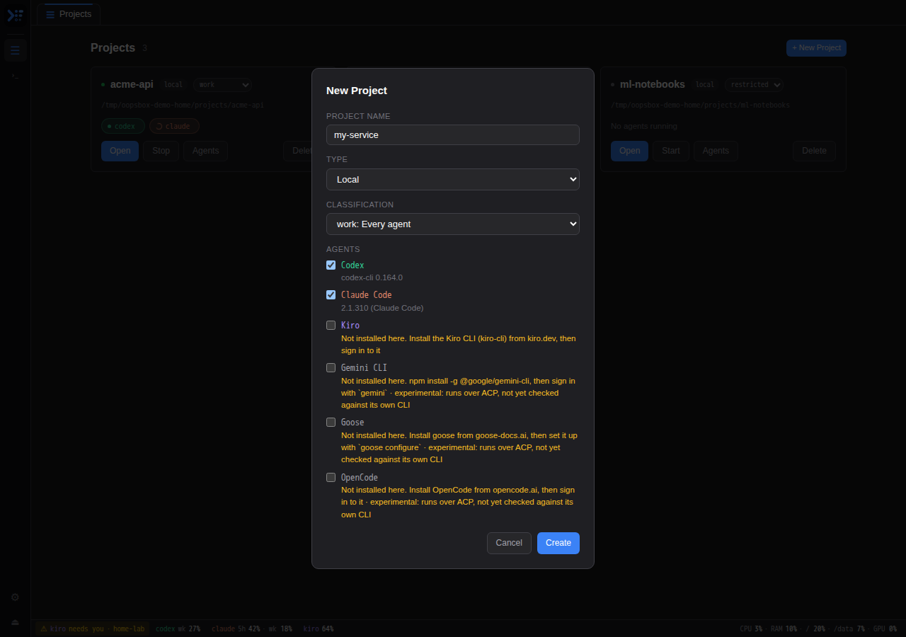
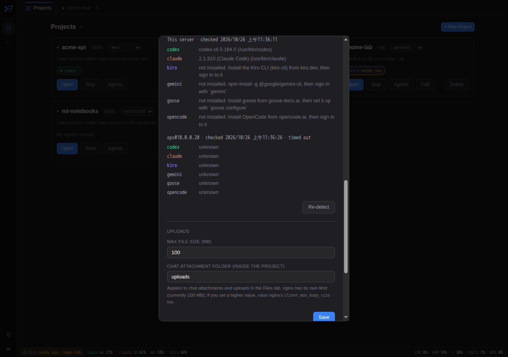

# OopsBox user guide

[繁體中文](user-guide.zh-TW.md)

This guide is for using OopsBox once it is installed. To install it, see the [README](../README.md#install).

- [Signing in](#signing-in)
- [Projects](#projects)
- [Choosing a project's agents](#choosing-a-projects-agents)
- [SSH projects](#ssh-projects)
- [More folders](#more-folders)
- [Chatting with an agent](#chatting-with-an-agent)
- [What the agents share](#what-the-agents-share)
- [When an agent needs you](#when-an-agent-needs-you)
- [Terminals](#terminals)
- [Files](#files)
- [The status bar](#the-status-bar)
- [Settings](#settings)
- [Phone and iPad](#phone-and-ipad)
- [Experimental agents](#experimental-agents)
- [Troubleshooting](#troubleshooting)

## Signing in

Open OopsBox in a browser and sign in with the username and password set at install. Change them in **Settings → Login Credentials**.

Use the HTTPS address if you have one (for example `https://<machine>.<tailnet>.ts.net:9444` through `tailscale serve`). Push notifications and installing OopsBox as an app only work over HTTPS.

## Projects

The **Projects** tab (☰, always the first tab) shows a card per project.

| On the card | What it means |
|---|---|
| Dot before the name | Green: something of the project is running |
| `local` / `ssh` | Where the project's files and agents are |
| Classification menu | `personal`, `work` or `restricted`: which agents the project may use (see below) |
| Agent chips | The agents running now. A spinner while one works; yellow **needs you** when one waits for you |
| **Open** | Opens the project in its own tab |
| **Start / Stop** | Starts the project's agents, or stops them and its terminal |
| **Agents** | Choose which agents the project uses |
| **Folders** | More folders the project's agents may work in |
| **Edit** | Connection settings of an SSH project |
| **Delete** | Removes the project from OopsBox |

### Creating a project

Press **+ New Project** and fill in:

- **Project Name**: letters, numbers, `.`, `_` and `-`.
- **Type**:
  - **Local**: the project lives on the OopsBox server, in `~/projects/<name>`.
  - **SSH Remote**: the files are on another machine, in **Remote Path**. Give a password or a key path; leave both empty to use the server's SSH keys. See [SSH projects](#ssh-projects).
- **Classification** and **Agents**: see the next section.

If `~/projects/<name>` already exists (for example from a project you removed earlier), OopsBox takes it up as it is and changes nothing in it.

### Classification

The classification is a ceiling: it decides which agents may ever work on the project.

| Classification | Claude, Codex | Kiro | Experimental agents |
|---|---|---|---|
| `personal` | allowed | allowed, unticked by default | allowed |
| `work` | allowed | allowed | allowed |
| `restricted` | blocked | allowed | blocked |

Switching to a stricter classification stops the agents it blocks right away. Use `restricted` for code that must not go to the cloud agents.

### Deleting a project

**Delete** removes the project from OopsBox but keeps its folder and its chat history, so creating a project of the same name brings everything back. To delete those too, tick **Also delete the folder and the project's chat history** and type the project name. This cannot be undone.

## Choosing a project's agents

Each project uses the agents you tick, in that order. The first one is where a project opens until you use another.

- **When you create a project**, the list shows every agent its classification allows, with what OopsBox found on that machine:
  - a version, such as `codex-cli 0.164.0`: installed, ticked by default;
  - **Not installed here**, in yellow, with how to install it: unticked, but you can still tick it (say, if you are about to install it);
  - **Not checked on this machine yet**: OopsBox has not looked yet (it does when it starts, and on Re-detect).
- **Later**, press **Agents** on the project card. Unticking an agent that is running stops it; its conversations stay, and come back when you tick it again.
- Agents the classification blocks are not listed, and stay blocked whatever you tick.

Projects made before this choice existed keep using every agent their classification allows, until you change it.

### Which agents a machine has

**Settings → Agents** lists which agents are installed on the OopsBox server, their version and path. Every agent runs there, SSH projects included. OopsBox checks when it starts; press **Re-detect** after installing or updating an agent.

## SSH projects

An SSH project's files live on another machine, but its agents run on the OopsBox server, where they are installed and signed in. Nothing needs installing on the remote machine besides an SSH server.

- When an agent starts, OopsBox opens one SSH connection to the machine (with the project's password or key) and mounts **Remote Path** on the server with sshfs. The agent works in that mounted folder, so reading and editing files works as in a local project.
- To run something *on the remote machine* (build, test, check a service), agents use the `remote` command, for example `remote make test`. It runs in **Remote Path** over the same connection. They are told this when they start.
- If the connection drops, it is opened again the next time an agent starts.
- **Edit** stops the project's agents and closes the connection, so the next start uses the new settings.
- **Open in Terminal** is not available for SSH projects: their Terminal tab is a shell on the remote machine, where the agents do not run.
- The OopsBox server needs `sshfs` installed.

## More folders

Sometimes a task spans more than the project's folder: a shared library, a config repo, a customer's files. Press **Folders** on the project card and list other folders on the OopsBox server, one per line (absolute paths). Every agent of the project may then work in them:

- Claude gets them with `--add-dir`;
- Codex may write to them in its workspace sandbox;
- every agent is told about them when it starts (Kiro and the experimental agents may still ask permission for files there).

Agents that are running start again to pick up the change. For an SSH project these are folders of the OopsBox server, not of the remote machine.

## Chatting with an agent

Open a project and pick an agent from the bar at the top of the chat. Each agent has its own colour: Claude orange, Codex green, Kiro violet, experimental agents grey with an **exp** tag.

- **Send**: Enter. Shift+Enter for a new line.
- **While it works**: send another message to steer the current turn, or press **Interrupt**. ⏻ stops the agent.
- **Slash commands**: type `/` for the agent's commands. Some open a picker (`/model`) or a panel (`/usage`, `/context`, `/mcp`); one that only works in the agent's own interface offers to continue in a terminal.
- **Models and modes**: pick them from the menus in the chat bar.
- **Permissions**: when the agent asks, an Allow / Deny card appears. **Autopilot** allows everything for the current conversation.
- **Files and images**: attach them with the paperclip, drop them on the chat, or paste an image. They are saved in the project's `uploads/` folder. Type `@` to search the project's files.
- **New chat** starts a new conversation. 🕘 lists past ones, including other agents' history, so you can switch back.
- **Subagents**: when an agent hands work to subagents (Claude's Agent tool, Codex's spawn_agent), each one gets a card: its type and task, how many steps it has taken, how long it has run, and the step it is on now. Expand it for its steps, what it was asked and what it returned. The agent's button shows `+N` while N subagents run, and so does its chip on the project card.
- **Links to files**: when an agent links a file of the project (for example a report it wrote in `docs/`), clicking it opens the file in the Files tab.
- **Open in Terminal** continues the same conversation in the agent's own CLI, for anything the chat cannot do.

Agents keep running when you close the page. When OopsBox restarts, agents that were running come back on the conversation they were in. An agent you stopped stays stopped.

### What the agents share

Agents do not see each other's conversations. What they share is the project's memory, in `.memory/` in the project folder (on the OopsBox server, also for SSH projects; it is its own git repo and stays out of the project's):

- `activity.md` is written by OopsBox after every turn of every agent: what it was asked, which files it changed, what it answered. An agent starting work is shown the last few entries, so Codex knows what Claude just did.
- `STATUS.md` (Now / Next / Blocked) and `decisions/` are written by the agents themselves; they are told to update STATUS.md at the end of every turn that changed something.

## When an agent needs you

When an agent stops for a permission or a question:

- its chip on the project card turns yellow (**needs you**);
- the status bar shows **⚠ \<agent\> needs you · \<project\>** on every page; click it to go there;
- the browser tab title shows a count;
- every device with notifications turned on gets a push notification. Tap it to open that chat.

To turn notifications on, open **Settings → Notifications** on each device and press **Turn on for this device**, then **Send a test**. On an iPad or iPhone, first add OopsBox to the Home Screen from Safari (Share → Add to Home Screen) and open it from there; iOS only delivers web push to installed apps.

## Terminals

- **Terminal** in a project opens a shell in the project's folder (on the remote machine, in Remote Path, for an SSH project).
- **›_** in the sidebar opens a standalone shell in a new tab. Press it again for another one.
- Terminals keep running when you close the page or OopsBox restarts. Closing a standalone shell's tab ends it.
- On a touchscreen, the toolbar gives you the keys a keyboard would: ^C, Tab, arrows, Esc.

## Files

The **Files** tab browses the project: upload, download, rename, delete, and open files in an editor (code), a preview (Markdown, images, PDF). For an SSH project it shows the remote files next to the local ones.

## The status bar

The bar at the bottom shows each agent's usage (the share of each limit used), and the machine's CPU, memory, disks and GPU. Click an agent for the details and when its limits reset. On a phone it shows less; tap an agent for the rest.

You get a push notification when a limit passes the alert level, once per reset period. Set the level in **Settings → Notifications** (default 90%).

## Settings

⚙ in the sidebar opens Settings:

| Section | What it does |
|---|---|
| Login Credentials | Username and password |
| Claude Agent | An Anthropic API key and base URL, kept from an earlier version; the chat agents use their own sign-in |
| Git | Git user name and email on the server |
| Notifications | Push for this device, a test, the usage alert level |
| Agents | What each machine has installed; Re-detect |
| Uploads | Largest file you can upload, and the folder chat attachments go to |
| SSL | Certificate paths, if OopsBox itself serves HTTPS |

## Phone and iPad

OopsBox works in a mobile browser. For the best experience, install it as an app: Safari → Share → **Add to Home Screen**, or **Install** in Chrome's menu. On a phone, the chat bar wraps to two rows, the project tab shrinks to ☰, and tabs that do not fit are listed under **▾ N**.

## Experimental agents

Besides Claude Code, Codex and Kiro, OopsBox can run any of these if they are installed on the machine:

| Agent | Started as |
|---|---|
| Gemini CLI | `gemini --acp` |
| Goose | `goose acp` |
| OpenCode | `opencode acp` |

They speak ACP (Agent Client Protocol), so OopsBox runs them through the same driver as Kiro. They are **experimental**: nobody has yet checked that the chat gives you everything their own CLI does. In particular:

- they are never ticked by default, and `restricted` projects cannot use them;
- there is no usage in the status bar for them;
- slash commands are passed to the agent as text, without pickers or panels;
- there is no **Open in Terminal**.

To try one: install it on the machine and sign in to it in a terminal, press **Re-detect** in Settings → Agents, then tick it under **Agents** on a project.

## Troubleshooting

| Problem | What to do |
|---|---|
| An agent stays on an error after starting | Open a terminal and run the agent there: it is usually not signed in, or not installed on that machine (check Settings → Agents) |
| The chat stops updating | Reload the page. If it still does not update, check that the server is reachable; OopsBox reconnects by itself when it comes back |
| No push notifications | Use the HTTPS address; on iOS open OopsBox from the Home Screen; press **Send a test** in Settings → Notifications |
| When the login expires, the page jumps to another address (such as `http://…:9080`) | nginx sends absolute redirects: add `absolute_redirect off;` to OopsBox's `server` block and reload nginx |
| An SSH project's agent says `cannot connect` or `cannot mount` | Check the connection settings with **Edit** (host, user, password or key, Remote Path), then start the agent again. `sshfs` must be installed on the OopsBox server |
| "Not installed here" for an agent you installed | The agent must be on the PATH OopsBox uses (`~/.local/bin`, `~/.npm-global/bin` and the system PATH); press **Re-detect** |
